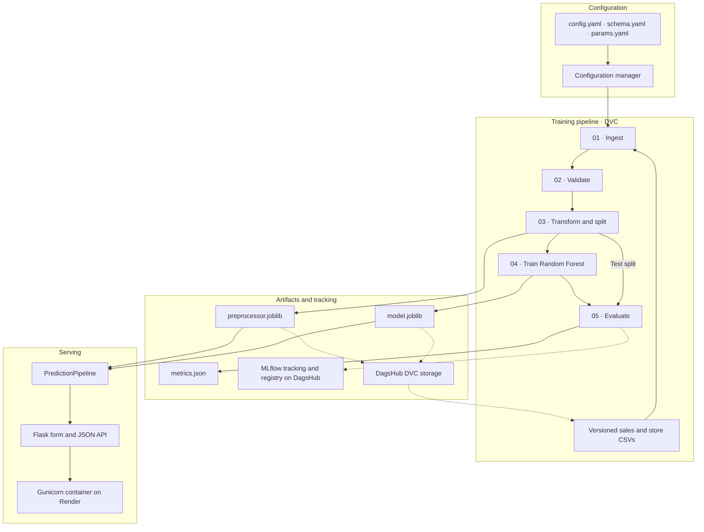

# 📈 Retail Sales Forecasting · End-to-End MLOps

A daily sales forecasting project that trains a Random Forest on historical store sales, promotion schedules, holidays, and competition data. The repository covers the workflow from notebook experiments to reproducible DVC pipelines, MLflow experiment tracking, and a Flask app with a prediction API.

**Render demo** · [Open the forecast app](https://datasciecne-project-forcasting.onrender.com/)

**Demo status** · The form loads. The last prediction check returned HTTP 503 because the model artifacts were missing.

---

## 📑 Table of Contents

- [System Architecture](#-system-architecture)
- [ML Pipeline Workflow](#-ml-pipeline-workflow)
- [Project Directory Structure](#-project-directory-structure)
- [Tech Stack](#-tech-stack)
- [Getting Started](#-getting-started)
- [Usage & Execution](#-usage--execution)
- [API Endpoints](#-api-endpoints)
- [Experiment Tracking & Model Registry](#-experiment-tracking--model-registry)
- [Deploy on Render](#-deploy-on-render)
- [Software Engineering Standards](#-software-engineering-standards)
- [License](#-license)
- [Author](#-author)

---

## 🏛 System Architecture

Training and inference share a fitted preprocessor and model. Pipeline settings, schema checks, and model parameters live in YAML, and DVC records the data and artifact versions used in each run.



DVC tracks the source dataset and generated artifacts and runs the first five stages in dependency order. DagsHub stores the DVC cache. MLflow records selected evaluation runs and registered model versions.

---

## 🔄 ML Pipeline Workflow

The project moves each ML stage from research to a runnable module in seven steps:

1. Prototype the stage in a research notebook and run it on real data.
2. Declare artifact paths in `config/config.yaml`, schema fields in `schema.yaml`, and tunable values in `params.yaml` as needed.
3. Define the stage's configuration dataclass.
4. Load and build the configuration through `ConfigurationManager`.
5. Move the verified logic into a component.
6. Connect the component to a pipeline runner.
7. Run the stage through its entry point and inspect the outputs and logs.

| Stage | Work | Output |
| --- | --- | --- |
| 01 · Ingestion | Join historical sales with store metadata | `artifacts/data_ingestion/raw.csv` |
| 02 · Validation | Check the ingested columns against `schema.yaml` | `artifacts/data_validation/status.txt` |
| 03 · Transformation | Derive calendar features, prepare missing and categorical values, and split the data | `train.csv`, `test.csv`, `preprocessor.joblib` |
| 04 · Training | Fit the Random Forest using `params.yaml` | `artifacts/model_trainer/model.joblib` |
| 05 · Evaluation | Calculate RMSE, MAE, and R² and optionally track a run in MLflow | `artifacts/model_evaluation/metrics.json` |
| 06 · Orchestration | Reproduce the training workflow and sync its cache | `dvc.yaml`, `dvc.lock`, DagsHub storage |
| 07 · Inference | Validate a single store-and-date input and run the saved model | Predicted daily sales |
| 08 · Web app | Serve predictions in a form and a JSON API | Flask application |
| 09 · Container and CI | Package the serving app and test the image | Docker image and GitHub Actions workflow |

---

## 📁 Project Directory Structure

```text
.
├── .github/workflows/main.yaml      # Container build, tests, and publishing
├── config/config.yaml               # Artifact paths and tracking settings
├── research/
│   ├── 01_data_ingestion.ipynb
│   ├── 02_data_validation.ipynb
│   ├── 03_data_transformation.ipynb
│   ├── 04_model_training.ipynb
│   ├── 05_model_evaluation.ipynb
│   └── 07_prediction_pipeline.ipynb
├── src/forcastingproject/
│   ├── components/                 # Data and model operations
│   ├── config/                      # Configuration manager
│   ├── entity/                      # Configuration dataclasses
│   ├── pipeline/                    # Stage runners and prediction pipeline
│   └── utils/                       # YAML, JSON, and file helpers
├── static/                          # Web stylesheet
├── templates/                       # Flask HTML template
├── tests/                           # Flask route and readiness tests
├── app.py                           # Flask entry point
├── main.py                          # Training and tracked evaluation entry point
├── data.dvc                         # Source dataset pointer
├── dvc.yaml                         # Reproducible pipeline definition
├── dvc.lock                         # Recorded dependency and output versions
├── params.yaml                      # Model settings
├── schema.yaml                      # Input schema
├── requirements.txt                 # Training and development dependencies
├── requirements-serving.txt         # Pinned serving dependencies
├── Dockerfile                       # Gunicorn serving image
└── docker-compose.yaml              # Local service and artifact mounts
```

---

## 🛠 Tech Stack

| Layer | Tools |
| --- | --- |
| Data and modeling | Python 3.14, pandas, NumPy, scikit-learn, joblib |
| Versioning and orchestration | Git, DVC, DagsHub remote storage |
| Experiment tracking | MLflow and DagsHub Model Registry |
| Configuration | PyYAML, ConfigBox, frozen dataclasses |
| Serving | Flask, Jinja2, Gunicorn, Docker Compose |
| Automation and hosting | GitHub Actions, GitHub Container Registry, Render |

---

## 🚀 Getting Started

### Prerequisites

Use Python 3.14 for the provided artifacts. The serving environment pins scikit-learn and other model-loading dependencies in `requirements-serving.txt`. Install Docker and Compose to use the container.

### Installation

```bash
git clone --branch feature/container-ci-cd --single-branch \
  https://github.com/sheshpalsingh01/DataSciecne_Project_forcasting.git
cd DataSciecne_Project_forcasting

python3.14 -m venv .venv
source .venv/bin/activate
python -m pip install -r requirements.txt -r requirements-serving.txt
```

### Environment configuration

Configure the `dagshub` DVC remote credentials locally using `dvc remote modify --local` or the `AWS_ACCESS_KEY_ID` and `AWS_SECRET_ACCESS_KEY` environment variables for DagsHub's S3-compatible endpoint. Keep local credentials out of Git.

For tracked runs, export `MLFLOW_TRACKING_USERNAME` and `MLFLOW_TRACKING_PASSWORD` in the shell that launches the pipeline. Use a DagsHub token with write access for the password. `MLFLOW_TRACKING_URI` is optional because `config/config.yaml` sets the project URI.

---

## 💻 Usage & Execution

### 1. Reproduce the ML pipeline

```bash
dvc pull
dvc dag
dvc repro
dvc metrics show
```

A second reproduction skips unchanged stages. Changing the trainer settings in `params.yaml` starts reproduction at model training. Use `dvc push` to sync updated artifacts when you have write access.

For a full run with MLflow tracking after fetching the data, use `python main.py`. DVC writes local evaluation metrics during reproduction. It leaves remote experiment logging to the tracked entry points.

### 2. Launch the web application

```bash
docker compose up --build --wait
curl -fsS http://127.0.0.1:5000/health
```

Open `http://127.0.0.1:5000/` and submit a store and date. Compose mounts the model and preprocessor read-only. Stop the service with `docker compose down`. For development without Docker, run `flask --app app run` with the same artifacts in place.

---

## 🌐 API Endpoints

| Method | Path | Purpose |
| --- | --- | --- |
| GET | `/` | Open the forecast form |
| POST | `/predict` | Submit the HTML form |
| POST | `/api/predict` | Predict sales from a JSON payload |
| GET | `/health` | Check whether both inference artifacts load |

### Prediction input

| Field | Meaning |
| --- | --- |
| `Store`, `Date` | Positive store ID and forecast date in ISO format |
| `StoreType`, `Assortment` | Store and merchandise categories |
| `Open`, `Promo`, `SchoolHoliday`, `Promo2` | Flags encoded as `0` or `1` |
| `StateHoliday` | `0` for none or `a`, `b`, `c` for the training dataset's holiday categories |

```bash
curl -fsS http://127.0.0.1:5000/api/predict \
  -H 'Content-Type: application/json' \
  -d '{"Store":1,"Date":"2015-07-31","Open":1,"Promo":1,"StateHoliday":"0","SchoolHoliday":1,"StoreType":"c","Assortment":"a","Promo2":0}'
```

With the saved baseline artifacts, the response contains a numeric `sales` value of approximately `7752.08`. Invalid payloads return HTTP 400. Missing inference artifacts return HTTP 503.

Optional inputs are `CompetitionDistance`, `CompetitionOpenSinceMonth`, `CompetitionOpenSinceYear`, `Promo2SinceWeek`, `Promo2SinceYear`, and `PromoInterval`. The same payload also works with `python -m src.forcastingproject.pipeline.prediction_pipeline '<JSON payload>'`.

---

## 📊 Experiment Tracking & Model Registry

The baseline Random Forest uses 30 trees and a maximum depth of 16. These scores are from the project's random 80/20 holdout of historical observations.

| Metric | Value |
| --- | ---: |
| RMSE | 1,434.79 |
| MAE | 925.94 |
| R² | 0.8608 |

```bash
# Save local evaluation metrics
python -m src.forcastingproject.pipeline.model_evaluation_pipeline --local-only

# Log a separate MLflow run and register the model
python -m src.forcastingproject.pipeline.model_evaluation_pipeline
```

The tracked run records the settings from `params.yaml`, metrics, and the model signature. MLflow registers the model as `sales-forecasting`. A verified baseline run registered version 1. [DagsHub baseline run](https://dagshub.com/sheshpalsingh2024/DataSciecne_Project_forcasting.mlflow/#/experiments/0/runs/273d1004094c40e5b79d450d63e74350)

---

## ☁️ Deploy on Render

Create a **Docker Web Service** on the **Free** plan, use the Dockerfile's default command, and set the HTTP health check path to `/health`. The server listens on Render's `PORT`. [Render Docker setup](https://render.com/docs/docker) · [Health check settings](https://render.com/docs/health-checks)

Set the following environment variables in the Render dashboard:

| Variable | Value |
| --- | --- |
| `FORECAST_FETCH_ARTIFACTS` | `1` |
| `AWS_ACCESS_KEY_ID` | DagsHub storage access key |
| `AWS_SECRET_ACCESS_KEY` | DagsHub storage secret key |

At startup the container downloads just the model and preprocessor versions recorded in `dvc.lock` from DagsHub. It verifies their DVC checksums before starting Gunicorn. Run `dvc push` before deploying a commit with new artifact versions. Render Free may sleep and discard local filesystem changes, so the download runs again when a new container starts. [Render environment variables](https://render.com/docs/configure-environment-variables) · [Render Free limits](https://render.com/docs/free)

---

## 🛡 Software Engineering Standards

- Frozen dataclasses define configuration objects, and the configuration manager reads YAML and resolves artifact paths.
- Each stage has a focused component and a runner. The app uses the same prediction pipeline for form and JSON requests.
- The fitted preprocessor travels with the model, and the Gunicorn image pins serving dependencies to match the saved artifacts.
- Readiness checks load both inference artifacts before reporting that the service can accept forecasts.

### Continuous integration

GitHub Actions builds the Docker image and runs the Flask unit tests on pushes and pull requests. The workflow publishes passing default-branch builds to GitHub Container Registry with the commit SHA as the tag. Render deployment is configured separately in the Render dashboard.

Run the same tests locally with:

```bash
python -m unittest discover -s tests -v
```

---


## 👤 Author

Sheshpal Singh · [GitHub](https://github.com/sheshpalsingh01) · [DagsHub](https://dagshub.com/sheshpalsingh2024)
